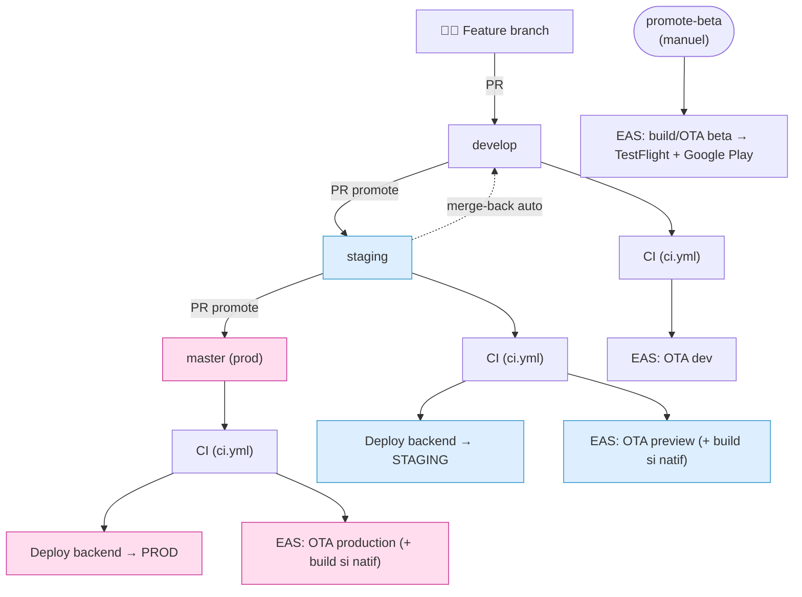
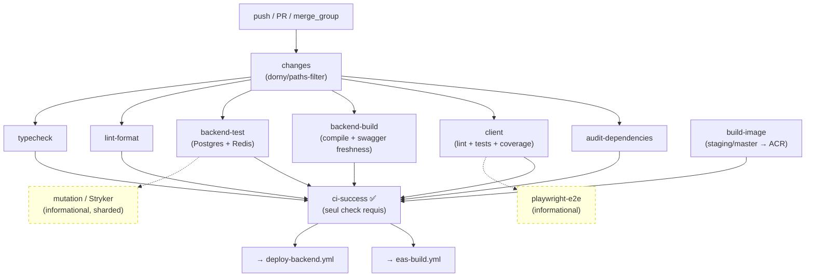
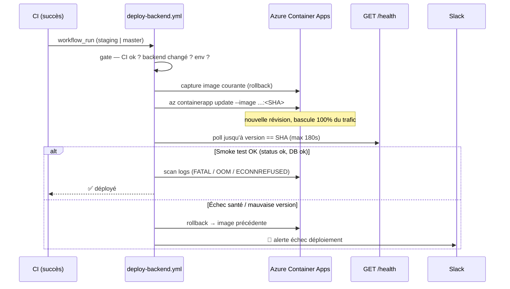
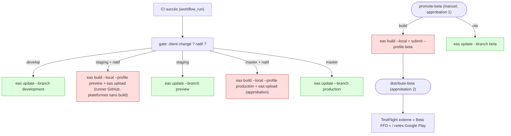
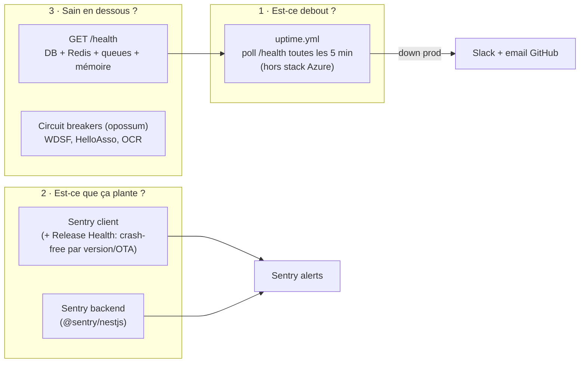

# CI/CD — Guide complet FFD-Connect

Documentation de référence du pipeline CI/CD : intégration continue, déploiement
backend (Azure Container Apps), déploiement mobile (EAS), release, et monitoring.

> **Quick reference** : pour la table des jobs bloquants / la liste des échecs CI
> courants, voir [`ci-cd-minimal.md`](./ci-cd-minimal.md).
> **Décisions** : voir [ADR-0016 (stratégie CI par tiers)](../adr/0016-ci-tiered-execution-strategy.md)
> et [ADR-0011 (monitoring)](../adr/0011-monitoring-newrelic-sentry.md).

Les schémas ci-dessous sont en [Mermaid](https://mermaid.js.org/) — rendus
automatiquement par GitHub et Starlight.

---

## 1. Vue d'ensemble — du commit à la prod

Le flux Git est **feature → develop → staging → master**, et chaque branche
déclenche une combinaison différente de CI, déploiement backend et build mobile.



**Règle d'or** : rien ne se déploie sans que la **CI passe** d'abord. Les workflows
de déploiement (`deploy-backend.yml`, `eas-build.yml`) se déclenchent sur
`workflow_run` **après succès de la CI**, jamais directement sur push.

| Branche          | CI                          | Backend                       | Mobile                                                    |
| ---------------- | --------------------------- | ----------------------------- | --------------------------------------------------------- |
| `feature/*` (PR) | ✅ complète (path-filtered) | —                             | —                                                         |
| `develop`        | ✅                          | —                             | OTA canal `development`                                   |
| `staging`        | ✅                          | 🚀 Container Apps **staging** | OTA canal `preview` (+ build natif si empreinte nouvelle) |
| `master`         | ✅                          | 🚀 Container Apps **prod**    | OTA canal `production` (+ build si natif)                 |
| `beta` (manuel)  | —                           | —                             | build/OTA canal `beta` → TestFlight                       |

---

## 2. Intégration continue — `ci.yml`

Une seule pipeline, exécutée en **tiers** selon l'événement et la branche (voir
ADR-0016). L'objectif : feedback rapide sur les PR, filet de sécurité complet sur
les branches protégées, sans revalider 3× le même code.



### Tiers d'exécution

| Tier              | Jobs                                                                           | Quand                                             |
| ----------------- | ------------------------------------------------------------------------------ | ------------------------------------------------- |
| **1 — Core**      | `backend-test`, `backend-build`, `client`                                      | Toujours (PR : si les chemins concernés changent) |
| **2 — PR gate**   | `playwright-e2e`, `mutation`, `audit-dependencies`, `typecheck`, `lint-format` | Sur PR (+ push master/hotfix pour audit)          |
| **3 — Prod gate** | `audit-dependencies`, build checks                                             | Aussi sur push `master` / `hotfix/**`             |

### Bloquant vs informationnel

- **Bloquant** : `typecheck`, `lint-format`, `backend-test`, `backend-build`,
  `client`, `audit-dependencies` et `build-image` (staging/master, seulement si
  la promotion touche le backend).
- **Landing** : plus d'image Docker. `ffd.gabin-simond.fr` est servi par GitHub
  Pages (`deploy-landing.yml`, sur push `staging`). La PR est protégée par
  l'étape `Build landing` (`pnpm --filter landing build`) du job `lint-format`,
  lancée quand la landing ou `docs/legal/**` changent.
- **Informationnel** (n'empêche pas le merge) : `playwright-e2e`, `mutation`.
  La couverture mutation complète est fournie par `mutation-nightly.yml`.

### Le job `ci-success`

C'est l'**agrégateur** : il lit le résultat de tous les jobs, traite `skipped`
(path-filtering) comme un succès, et échoue si un job bloquant est `failure`/`cancelled`.

> ⚠️ **Protection de branche** : le **seul** check requis est `CI Success`.
> Ne jamais lister les jobs individuels (surtout les shards `Mutation (…)`) comme
> requis — ils apparaissent/disparaissent selon le path-filtering.

### Optimisations clés

- **Cache pnpm** (`cache: 'pnpm'` + `--frozen-lockfile --prefer-offline`).
- **Cache Docker registry** sur ACR (`cache-to: type=registry,mode=max`), pour
  `build-image` seulement (push sur `staging`/`master`).
- **Pas de cache Docker GitHub Actions sur les PR** (#515) : `docker-build-check`
  construit à froid (~5 min, minutes gratuites en dépôt public). Avec
  `type=gha,mode=max`, chaque PR stockait ~1,5 Go de couches buildkit sous
  `refs/pull/<n>/merge`, illisibles par toute autre branche, qui chassaient du
  quota de 10 Go les caches partagés (store pnpm de `develop`, eas-cli, caches
  des builds natifs). Ne pas réintroduire de `cache-to` sur un job de PR.
- **Path-filter** (`dorny/paths-filter`) : skip backend si seul le client change,
  et inversement. Les packages partagés (`packages/**`, `pnpm-lock.yaml`) déclenchent tout.
- **Stryker** sharded + `--since` + incrémental.
- **Miroir Docker Hub** (#228) : les conteneurs de service de `backend-test`
  (`postgres`, `redis`) sont tirés depuis `mirror.gcr.io/library/…`, et les
  jobs buildx (`docker-build-check`, `build-image`) configurent buildkit avec
  `[registry."docker.io"] mirrors = ["mirror.gcr.io"]`. Gratuit, sans compte :
  la limite de pull anonyme Docker Hub (`429 toomanyrequests`) ne fait plus
  tomber le merge gate. Le `Dockerfile` garde `FROM node:22-alpine` (buildkit
  retombe sur docker.io si le miroir n'a pas l'image).
- **Actions pinnées par SHA** (défense supply-chain contre le déplacement de tag).

**Durée réelle** : ~3,4 min sur un run typique.

---

## 3. Déploiement backend — `deploy-backend.yml`

Cible : **Azure Container Apps** en mode _single-revision_ (la VM est retirée).
Authentification **OIDC** (aucun secret Azure statique à faire tourner).



**Points importants**

- `az containerapp update --image <ACR>/…:<sha>` crée une nouvelle révision et
  bascule 100 % du trafic. L'image est **taggée par SHA** (immuable, reproductible).
- **Smoke test** : on attend que la nouvelle révision réponde avec
  `version == SHA déployé` (une vieille révision répond encore `200` pendant la
  bascule → on ne se contente pas d'un `200`, on vérifie la version). Cold start
  Container Apps : jusqu'à 180 s.
- **Rollback auto** sur échec : re-`update` vers l'image précédente.
  ⚠️ **Toutes les migrations doivent être rétrocompatibles** — un rollback
  d'image laisse le schéma DB déjà migré en avance.
- **Déploiement seulement si le backend change** : le job `changes` de `ci.yml`
  (sortie `backend_image`) calcule, sur un push `staging`/`master`, le diff
  entre le **SHA réellement déployé** sur l'environnement et `HEAD`, restreint à
  ce que copie le Dockerfile backend (`apps/backend/`, `packages/shared/`,
  `packages/jest-config/`, `patches/`, `scripts/`, manifestes `package.json`,
  `pnpm-lock.yaml`, `pnpm-workspace.yaml`, `.npmrc`, `.dockerignore`) et
  `deploy-backend.yml`.
  Le SHA déployé est lu via l'API Actions (gratuit, ne réveille pas l'app :
  **jamais** `/health`) : dernier run de `deploy-backend.yml` dont le job
  `Deploy to Staging` / `Deploy to Production` a conclu `success`. Un
  déploiement annulé par rollback échoue ce job et ne compte donc pas. Le SHA
  est pris dans le **titre du run** (`run-name: Deploy Backend · <branche> @
<sha>`) : un run `workflow_run` porte le `head_sha` de develop, et les
  deployments GitHub créés par `environment:` aussi — ni l'un ni l'autre ne
  donne le commit déployé. Ne pas modifier ce `run-name` sans adapter `ci.yml`.
  SHA introuvable (premier passage après la mise en place), fetch ou diff en
  échec → on construit (fail-safe).
  `build-image` (« Build & Push Backend Image ») ne construit l'image `<sha>`
  que dans ce cas, et le `gate` de `deploy-backend.yml` déploie **ssi ce job a
  réussi** dans le run CI déclencheur (lu via l'API Actions). Une seule décision,
  donc jamais de déploiement vers un tag inexistant. Chaque promotion sans
  changement backend évite un build d'image, un réveil à froid de l'app et une
  révision.
  Comme la base est le SHA déployé, une promotion annulée (`cancel-in-progress`
  de la CI), une CI en échec non relancée ou un rollback ne font **pas** perdre
  de changement backend : la promotion suivante le voit encore dans son diff.
- Conséquences à connaître :
  - Après une promotion sans changement backend, la `version` de `/health` est
    le SHA du **dernier déploiement**, pas la pointe de `staging`. C'est normal.
  - Les correctifs de l'image de base (`node:22-alpine`) n'arrivent plus qu'avec
    un changement backend. Pas de reconstruction hebdomadaire automatique (elle
    imposerait un déploiement, donc un réveil) : pour forcer une mise à jour,
    promouvoir un changement qui touche un chemin backend (une montée de
    dépendance suffit). Relancer la CI seule ne reconstruit rien (diff vide).
    Trivy (report-only) signale les CVE à chaque build.
- `concurrency: cancel-in-progress: false` — un déploiement en cours n'est **jamais**
  annulé, les suivants sont mis en file.
- La prod est protégée par l'**Environment GitHub `production`** (approbation
  manuelle possible selon la config des reviewers).

Infra : `infra/terraform/`.

---

## 4. Déploiement mobile — `eas-build.yml`

Deux modes : **OTA** (`eas update`, gratuit, instantané, JS/asset only) et **build
natif** (requis si le code natif/config/runtime change). Tous les profils
(preview, beta, production ; iOS et Android) se construisent par défaut **sur
un runner GitHub** (`eas build --local`, #508), hors quota EAS et gratuit en
dépôt public ; le build cloud EAS (`eas build`, quota du plan gratuit) reste
un secours manuel. Détail : [Builds natifs sur runner GitHub](#builds-natifs-sur-runner-github-508).



### Canaux / environnements

| Branche         | Canal EAS     | Environnement EAS | Distribution         |
| --------------- | ------------- | ----------------- | -------------------- |
| `develop`       | `development` | development       | interne (dev client) |
| `staging`       | `preview`     | preview           | interne              |
| `beta` (manuel) | `beta`        | beta              | **TestFlight**       |
| `master`        | `production`  | production        | stores               |

> **Injection d'env** : `eas update --environment <env>` lit les variables
> `EXPO_PUBLIC_*` depuis l'**environnement EAS** (dashboard), **pas** depuis
> `eas.json` (qui ne vaut que pour `eas build`). Toujours corriger les deux.
> `runtimeVersion` : **`policy: "fingerprint"`**, une empreinte du code natif
> calculée par Expo (plus de numéro à bumper). Une OTA n'atteint que les builds
> de même empreinte ; les numéros de version en sont exclus
> (`apps/client/fingerprint.config.js`). L'empreinte dépend de la variante
> (`EXPO_PUBLIC_APP_ENV`) : chaque `eas update` de la CI est suivi de
> `scripts/check-ota-reach.sh`, qui vérifie qu'au moins un build du canal peut
> la recevoir (bloquant pour l'OTA beta, contrôlé aussi avant publication ;
> avertissement pour preview et production ; rien sur development, dont les dev
> clients n'ont pas de canal).
>
> **Bascule (oct. 2026)** : les binaires installés avant le passage à
> `fingerprint` portent la runtime `2.5.0` et ne reçoivent plus aucune OTA. Il
> faut un build natif par canal : preview (automatique à la promotion
> develop → staging, `app.config.js` ayant changé), beta (`promote-beta`,
> `action: build` — l'action `ota` échoue tant que ce build n'existe pas), et
> dev clients à reconstruire à la main.
> L'OTA beta n'utilise pas `--environment preview` (qui imposerait
> `EXPO_PUBLIC_APP_ENV=preview`) : elle reprend ses variables via `eas env:pull`.
>
> Sentry : release `<bundle id>@<version>+<build>` (ex.
> `fr.ffdanse.connect.beta@1.0.0+85`, le format des source maps du build),
> `dist` = build (bundle embarqué) ou id d'OTA, tags `git_sha` et `ota_runtime`.

### Client changé ? — base du diff

Le `gate` publie une OTA si `apps/client/`, `packages/shared/` ou
`pnpm-lock.yaml` ont changé **depuis le dernier commit dont l'OTA a été
publiée** depuis cette branche, et non depuis `HEAD^1` (#119). La CI de
`develop`/`staging`/`master` tourne en `cancel-in-progress` : quand la CI d'une
promotion N est annulée par la promotion N+1 (ou échoue sans relance),
`eas-build.yml` ne tourne jamais pour N ; avec `HEAD^1`, N+1 ne comparait que
N..N+1 et le changement client de N n'était jamais publié.

- Le SHA publié est lu via l'API Actions (`GITHUB_TOKEN`, aucun secret) :
  dernier run d'`eas-build.yml` dont l'étape **`Publish OTA update`** du job
  `OTA Update (development|preview|production)` a conclu `success`. L'étape et
  non le job : une fois `eas update` réussi, le bundle est parti, donc un run
  qui échoue ou est annulé **ensuite** (pendant le tag/release) compte bien.
  Une approbation production refusée, ou un run annulé **avant** cette étape,
  ne compte pas.
- Le SHA est pris dans le **titre du run**
  (`run-name: EAS Build & Update · <branche> @ <sha>`, même contrat que
  `deploy-backend.yml`) : un run `workflow_run` porte le `head_sha` de la
  branche par défaut, pas celui du commit publié. Ne pas modifier ce suffixe
  sans adapter le `gate`. Les runs manuels (`promote-beta`) ont un titre
  `bêta <action> <plateforme>[ n°<build>] (<ref>)` qui ne correspond jamais
  (et montre à l'approbateur ce qui va partir).
- **Fenêtre de recherche** : jusqu'à 5 pages de 100 runs d'`eas-build.yml`
  (toutes branches mélangées, du plus récent au plus ancien, arrêt dès qu'un
  run publié est trouvé ou qu'une page incomplète marque la fin), et au plus
  30 lectures de jobs. Au-delà, fail-safe.
- `eas update:list` n'est pas utilisé : il exige l'EAS CLI dans le gate et
  liste aussi les OTA publiées à la main depuis un poste local.
- **Fail-safe** : SHA introuvable (premier passage après la mise en place, API
  en erreur, hors fenêtre), fetch ou diff en échec → OTA publiée quand même
  (gratuite ; sur `staging`, elle crée aussi un tag + une prerelease
  `preview-*`).
- **Seul `client_changed` utilise cette base.** Les contrôles de chemins
  natifs (liste de repli de l'empreinte) et `eas_config` (`.easignore`,
  `eas.json`) restent calculés sur **ce push** (`HEAD^1..HEAD`, premier
  parent) : un changement d'`eas.json` dont l'OTA a été annulée ne repaie pas
  un build natif (~2 $) au push suivant, et un incident d'API n'en déclenche
  pas non plus. Sans commit de merge sur `staging`/`master`, tout est
  considéré comme changé (comportement historique).
- Effet de bord voulu : une relance de CI sans nouveau changement client ne
  republie plus l'OTA (le diff depuis le commit publié est vide).

### OTA vs build natif — quand rebuilder ?

Un **build natif** est nécessaire si le diff touche : dépendances natives,
`app.config.js`/plugins, permissions, ou l'icône/splash — c'est-à-dire quand
l'empreinte change (`npx expo-updates runtimeversion:resolve --platform ios`
avec la bonne `EXPO_PUBLIC_APP_ENV` pour la comparer à celle du build).
Sinon → **OTA** suffit (changements JS/TS/assets).

**Décision automatique (staging/master)** : pour **chaque plateforme** de
`AUTO_BUILD_PLATFORMS` (variable `env` en tête d'`eas-build.yml`, aujourd'hui
`ios`), le `gate` calcule l'empreinte du profil cible (`eas fingerprint:generate
--build-profile preview|production --platform <p>`) puis cherche un build EAS de
cette plateforme, de ce profil et de ce canal dont la `runtimeVersion` est cette
empreinte (statuts `finished`, `in-progress`, `in-queue`, `new`), puis, à
défaut, un build terminé portant cette empreinte (`--fingerprint-hash`) : c'est
ainsi qu'apparaît un binaire construit sur runner GitHub et enregistré par
`eas upload`, qui n'a ni canal ni profil (l'empreinte dépend de la variante).
Ce repli est **resserré (#511)** : jamais un build simulateur iOS, et sur iOS
seulement un build dont le bundle id est celui du profil (lu par
`eas config --profile <profil>`, `eas upload` le relève dans l'`Info.plist`) ;
bundle id illisible = pas de correspondance = build. Les uploads Android ne
portent aucun bundle id (eas-cli ne lit pas le manifeste) : sur Android,
l'empreinte seule fait foi. **Hypothèse assumée** : toute personne qui peut
faire `eas upload` sur le projet Expo est de confiance — le même accès publie
des OTA, bien plus dangereuses qu'un faux binaire, qui ne ferait que sauter un
build (impact disponibilité, l'OTA n'atteindrait aucun appareil :
`check-ota-reach.sh` le signale). Même filtre dans `check-ota-reach.sh`. L'empreinte
diffère d'une plateforme à l'autre : un changement natif propre à Android ne
modifie pas l'empreinte iOS, d'où une vérification par plateforme. Build natif
**dès qu'une plateforme n'a pas de build compatible**, et seulement pour celles-là
(sorties `native_platforms` / `build_platforms` du gate : une jambe de matrice
par plateforme dans `build-staging`/`build-production`) ; sinon OTA seule. Une
montée de `pnpm-lock.yaml` ou de `package.json` sans effet natif (Dependabot,
dépendance JS) ne relance donc pas un build de ~40 min. Si l'empreinte ne peut pas
être calculée (commit antérieur à `policy: "fingerprint"`, EAS injoignable), le
gate retombe sur l'ancienne liste de chemins (prudente) ; si c'est la liste des
builds EAS d'une plateforme qui est illisible, build natif de cette plateforme
(fail-safe). Dans tous les cas de repli, toutes les plateformes de
`AUTO_BUILD_PLATFORMS` sont construites. Coût : ~3 min de plus
sur le gate staging/master (installation du workspace), en minutes Actions
gratuites (dépôt public).

Limites :

- **Android pas encore construit automatiquement** : `AUTO_BUILD_PLATFORMS`
  vaut `ios`, donc ni empreinte Android vérifiée ni build Android sur
  preview/production. Le build Android de la beta Google Play passe par la
  promotion manuelle `promote-beta` (jambe Android, `action: build`), hors de
  ce gate.
  L'OTA beta vérifie déjà iOS et Android (`check-ota-reach.sh --strict`). Pour
  construire Android
  automatiquement : passer la variable à `ios android`, rien d'autre. Le premier
  push staging qui suit lancera alors un build Android preview (runner) : aucun
  build Android n'a encore d'empreinte comme runtime (vérifié le 2026-10-06 :
  builds `beta` en `2.5.0`, aucun build `preview` Android réussi).
- **`.easignore` et `eas.json` sont hors empreinte** : ils décident de ce qui
  part chez EAS et de l'environnement du build sans changer l'empreinte. Une
  modification de l'un d'eux force donc un build natif, même si un binaire de
  même empreinte existe.
- Un build **en cours** (`new`, `in-queue`, `in-progress`) de même empreinte
  suffit à éviter un nouveau build. S'il échoue ensuite, l'OTA publiée
  n'atteint personne jusqu'au prochain build : `check-ota-reach.sh` l'avertit
  dans le job `ota-staging`/`ota-production` ; relancer alors un build natif à
  la main (`eas build --profile preview --platform ios`).
  Un build sur runner n'est visible d'EAS qu'**après** son `eas upload` : deux
  promotions staging rapprochées construisent donc chacune (sans surcoût en
  dépôt public), et la plus récente annule la précédente
  (`cancel-in-progress`), dont le numéro de build distant est alors perdu.

La promotion manuelle `promote-beta` n'est pas concernée (`action: build`
construit toujours). Le groupe de concurrence `manual-beta` n'annule plus un
run manuel **en cours** : un deuxième déclenchement attend la fin du premier
au lieu de couper l'attente d'un build déjà payé. Attention : GitHub ne garde
qu'**un** run en attente par groupe ; un troisième déclenchement remplace (et
annule) le deuxième qui attendait, sans toucher au premier.

Le build natif de la promotion bêta (`action: build`) se fait par défaut **sur
un runner GitHub** (input `builder: github` : `eas build --local`, iOS sur
`macos-26` avec Xcode 26.6 épinglé, Android sur `ubuntu-24.04`), puis
`eas submit --path` ; `builder: eas` garde le build cloud EAS (quota du plan
gratuit). Coût : 0 $ en dépôt public (minutes standard gratuites, macOS
compris) ; ~35-45 min de macOS et ~25-35 min d'Ubuntu par promotion `all`.
En dépôt privé, une jambe iOS coûterait ~2-3 $ de minutes macOS, autant
qu'un build EAS. Secrets requis et procédure :
[changelog-beta.md](changelog-beta.md#build-sur-runner-github-builder--github).

### Builds natifs sur runner GitHub (#508)

Depuis #508, **tous** les builds natifs (preview, beta, production ; iOS et
Android) se font par défaut sur un runner GitHub avec `eas build --local` : iOS
sur `macos-26` (Xcode 26.6 épinglé, requis par `expo-modules-jsi` 57.1.1),
Android sur `ubuntu-24.04`. EAS reste utilisé pour les credentials de
signature (lus par eas-cli avec `EXPO_TOKEN`, `--freeze-credentials`), le
compteur de build distant (`autoIncrement`), les OTA et l'envoi aux stores.
`build-staging` et `build-production` passent par l'action composite
`.github/actions/eas-local-build` (mêmes réglages que la jambe
`builder: github` de `promote-beta`) : config Firebase décodée depuis un
secret d'environnement GitHub dans `$RUNNER_TEMP/eas-environment-secrets/`
(nom imposé, ignoré par `fingerprint.config.js`), bundle id vérifié avant et
après le build, pas d'envoi des source maps Sentry,
`EAS_BUILD_DISABLE_EXPO_DOCTOR_STEP=1`, eas-cli épinglé (`EAS_CLI_VERSION`).

| Profil       | Job                | Déclenchement                      | Environnement GitHub                        | Secrets Firebase (`_B64`)                                           | Après le build                                                    |
| ------------ | ------------------ | ---------------------------------- | ------------------------------------------- | ------------------------------------------------------------------- | ----------------------------------------------------------------- |
| `preview`    | `build-staging`    | push `staging`, empreinte nouvelle | `preview` (sans relecteur)                  | `FIREBASE_IOS_PLIST_PREVIEW`, `FIREBASE_ANDROID_JSON_PREVIEW`       | `eas upload` → lien d'installation ad hoc (expo.dev)              |
| `beta`       | `promote-beta`     | manuel (`action: build`)           | `testflight-build` (approbation)            | `FIREBASE_IOS_PLIST_BETA`, `FIREBASE_ANDROID_JSON_BETA`             | `eas submit --path` (TestFlight / Google Play), puis `eas upload` |
| `production` | `build-production` | push `master`, empreinte nouvelle  | `app-production` (**approbation de Gabin**) | `FIREBASE_IOS_PLIST_PRODUCTION`, `FIREBASE_ANDROID_JSON_PRODUCTION` | `eas upload` (envoi au store manuel, voir plus bas)               |

**Jamais d'artefact GitHub** : le dépôt est public (journaux et artefacts
lisibles par tous) et le binaire embarque les variables EAS « sensitive ». Le
binaire ne sort du runner que vers EAS ; seule son empreinte SHA-256 apparaît
dans le résumé du run.

**`eas upload`** (preview, production) enregistre le binaire local sur
expo.dev : page du build avec le lien d'installation ad hoc pour preview, et
un enregistrement EAS qui porte
l'**empreinte** du binaire (lue dans le binaire, sinon calculée par eas-cli),
que le `gate` et `scripts/check-ota-reach.sh` retrouvent
(`eas build:list --fingerprint-hash`). Sans cela, chaque push staging
reconstruirait. **Quota** : la commande téléverse un fichier et crée un
enregistrement « local build » (mutation `createLocalBuild`, eas-cli 24.12.1) ;
aucun job ne tourne sur l'infrastructure EAS, donc rien n'est décompté du quota
de builds du plan gratuit, qui compte les builds exécutés par EAS. À confirmer
sur la page _Usage_ du compte Expo après le premier build preview.

**Lien d'installation hors du résumé (#511)** : un build enregistré par
`eas upload` est en distribution _internal_, et EAS sert **sans connexion** son
manifeste d'installation
(`api.expo.dev/v2/projects/<projectId>/builds/<buildId>/manifest.plist`), qui
pointe vers une URL de téléchargement du binaire — vérifié le 2026-10-14 sur le
build preview iOS du 2026-10-13 (téléchargement anonyme possible). L'id du
projet est public (`app.config.js`) : l'id du build suffit donc. Ni le lien ni
l'id du build n'apparaissent plus dans le journal ni dans le résumé du run
(publics) : seule l'empreinte courte y figure, et le build se retrouve sur
expo.dev → _Builds_ (membres du compte Expo). Les résumés des runs antérieurs
contiennent encore des liens ; un `.ipa` preview ad hoc ne s'installe que sur
les appareils enregistrés, et les binaires expirent (≈ 90 jours).

**Beta (#510)** : après un `eas submit --path` terminé (`FINISHED`),
`promote-beta` enregistre aussi le binaire par `eas upload --fingerprint
<empreinte>` (étape en ligne, l'empreinte lue dans le binaire), pour que
l'OTA beta (`action: ota`, `check-ota-reach.sh --strict`) trouve ce binaire,
qu'aucun build EAS ne représente. L'étape n'est **jamais bloquante** : un échec
laisse un `::warning::`, l'envoi au store prime. Secours : quand l'envoi au
store est terminé, `release-beta` écrit en **première ligne** de la release
`beta-<version>-<plateforme>-<n°>` la phrase « Runtime fingerprint:
\`<empreinte>\`. », que `check-ota-reach.sh` (canal beta seulement) accepte
aussi — uniquement dans la première ligne d'une release créée par
`github-actions[bot]` (les notes qui suivent viennent des PR). Le jeton de
lecture des releases n'est passé qu'au script de contrôle
(`RELEASES_READ_TOKEN`), jamais à eas-cli. L'OTA beta exécute la version du
script du commit du **workflow** (develop), pas celle de staging.

Build iOS 27 (`beta-1.0.0-ios-27`, construit sur runner avant #510) : ni
`eas upload` ni binaire conservé. Son empreinte, relevée dans le journal du run
38363467108 (« Resolved runtime version:
c2ab529a0fe638db1458533bbcc1c6c3d9ad4b53 »), a été **ajoutée à la main** en
première ligne de sa release le 2026-10-13 (release toujours signée
`github-actions[bot]`) : l'OTA beta le trouve. Rien d'autre à faire.

**Production** : le binaire (`.ipa` store, `.aab`) est enregistré par
`eas upload`, pas envoyé au store. Comme avant #508, l'envoi reste manuel et
soumis à l'accord de Gabin : télécharger le binaire depuis la page du build sur
expo.dev, puis `eas submit --platform <p> --profile production --path <fichier>`.

**Secours `builder=eas`** : la variable de dépôt `NATIVE_BUILDER` (absente =
runner GitHub) bascule `build-staging` et `build-production` sur un build cloud
EAS (une seule jambe `eas`, `--platform all|ios|android` comme avant #508) :

```bash
gh variable set NATIVE_BUILDER --body eas --repo SIMOND-ANCE-BROS/FFD-Connect   # secours
gh variable delete NATIVE_BUILDER --repo SIMOND-ANCE-BROS/FFD-Connect           # retour au runner
```

puis relancer la CI du commit (le nouveau run d'`eas-build.yml` lit la
variable). Pour la beta, l'input `builder: eas` de `promote-beta` joue ce rôle.

**Secrets à poser** (une fois, par le propriétaire ; jamais de valeur dans un
ticket ou un journal), depuis la racine du dépôt, avec les fichiers de la
Firebase Console (`apps/client/firebase/`, jamais committés) :

```bash
base64 < apps/client/firebase/GoogleService-Info.preview.plist \
  | gh secret set FIREBASE_IOS_PLIST_PREVIEW_B64 --env preview --repo SIMOND-ANCE-BROS/FFD-Connect
base64 < apps/client/firebase/google-services.preview.json \
  | gh secret set FIREBASE_ANDROID_JSON_PREVIEW_B64 --env preview --repo SIMOND-ANCE-BROS/FFD-Connect
base64 < apps/client/firebase/GoogleService-Info.production.plist \
  | gh secret set FIREBASE_IOS_PLIST_PRODUCTION_B64 --env app-production --repo SIMOND-ANCE-BROS/FFD-Connect
base64 < apps/client/firebase/google-services.production.json \
  | gh secret set FIREBASE_ANDROID_JSON_PRODUCTION_B64 --env app-production --repo SIMOND-ANCE-BROS/FFD-Connect
gh secret list --env preview --repo SIMOND-ANCE-BROS/FFD-Connect          # noms seulement
gh secret list --env app-production --repo SIMOND-ANCE-BROS/FFD-Connect
```

Un secret absent fait échouer la jambe **avant** le build (aucun numéro de
build consommé), en nommant le secret manquant. Seules les plateformes de
`AUTO_BUILD_PLATFORMS` (aujourd'hui `ios`) sont construites automatiquement.

**Actions locales de `promote-beta` (#532)** — le workflow est pris sur la
branche qui le lance (`develop` en pratique), mais le job construit le code de
`staging`. Un `uses: ./.github/actions/<x>` se résout dans le workspace, donc
sur `staging` : une action ajoutée ou modifiée sur `develop` faisait échouer le
build bêta tant qu'elle n'était pas promue (run 38397117868 :
`android-gradle-runner` introuvable). Le job extrait donc en plus
`.github/actions` du commit du workflow (`github.sha`, sparse checkout,
profondeur 1) dans `.workflow-actions/`, ignoré localement par
`.git/info/exclude` (arbre propre pour `eas build`, rien dans l'archive), et
appelle toutes ses actions locales depuis `./.workflow-actions/.github/actions/`.
Le code construit, le lockfile, les clés de cache (`hashFiles`) et `.nvmrc`
restent ceux de `staging`. Règle : une action appelée par `promote-beta` ne
doit pas appeler elle-même une autre action locale (`./…` retomberait sur le
workspace, donc sur `staging`) ; `eas-local-build`, qui le fait, n'est utilisée
que par les jobs automatiques (paragraphe suivant). `promote-beta` garde ce
dossier à part plutôt que la superposition ci-dessous, car ses modes `resume`
et `distribute` font un `git checkout` d'un commit plus ancien, que git
refuserait sur des fichiers superposés.

**Actions locales des jobs `workflow_run` (#579)** — un `workflow_run` prend
toujours le YAML de la branche par défaut (`develop`, commit `github.sha`),
mais `gate`, `ota-development`, `build-staging`, `ota-staging`,
`build-production` et `ota-production` construisent
`workflow_run.head_sha` (le commit de `staging` ou `master`). Sans
correction, leurs `uses: ./.github/actions/<x>` venaient de la branche
construite : `master`, gelée, n'a ni `eas-local-build` ni ses sous-actions, et
le prochain build natif de production aurait échoué (« Can't find
'action.yml' »). `eas-local-build` appelant elle-même trois actions locales, le
dossier à part de #532 ne suffit pas : chaque job, juste après son checkout,
extrait `.github/actions` de `github.sha` (sparse, profondeur 1, sans
identifiants conservés) dans `.workflow-actions/`, puis l'action
`.github/actions/use-workflow-actions` **remplace** `.github/actions` du
workspace par cette copie. L'état git reste celui du commit construit : les
fichiers suivis de `.github/actions` passent en `skip-worktree`, les nouveaux
sont ignorés localement (`.git/info/exclude`), le dossier à part est supprimé,
et l'action échoue si `git status` n'est pas vide. `eas build`
(`requireCommit`) voit donc un arbre propre et archive le commit, sans la
copie. Lockfile, `.nvmrc` et clés de cache (`hashFiles`) restent ceux de la
branche construite. Dans `gate`, ces deux étapes ne tournent que pour
`staging`/`master` et sont non bloquantes (repli sur la décision par chemins,
comme les étapes d'empreinte). Contrainte : un job qui utilise cette action ne
doit plus changer de commit ensuite (`git checkout <sha>`).

Vérifier sur un run réel (push sur `staging`, puis `master` au redémarrage de
la prod) : dans chaque job, l'étape « Use the workflow's local actions » liste
les actions prises sur le commit du workflow, et le build ou l'OTA se déroule
comme avant. En cas d'échec « working tree is not clean », lire la liste
affichée : un fichier hors `.github/actions` modifié par une étape précédente.

**Accélérations (#512)** — mesures du build iOS bêta 27 (run 38363467108,
~39 min) : `pnpm install` 2 min, eas-cli 1 min 25, build 27 min 37 (dont
`pod install` 3 min et compilation Xcode 19 min 24, ~985 fichiers C/ObjC/C++
recompilés), sauvegarde du cache pnpm 2 min 54.

- **Pas de cache pnpm sur macOS** (`.github/actions/setup-pnpm`) : la clé
  exacte du lockfile n'y était jamais retrouvée (builds rares), et la
  sauvegarde coûtait ~3 min et 1,4 Go de quota de cache. Ubuntu inchangé.
- **ccache + CocoaPods** (`.github/actions/native-build-cache`, iOS, **preview
  et bêta seulement** — jamais `build-production`, entrée `native-cache` de
  `eas-local-build`) :
  restaurés avant `eas build --local`, sauvegardés après un build réussi
  (seulement si la clé exacte manquait). ccache 4.14.1 téléchargé et vérifié
  par SHA-256, activé par `USE_CCACHE=1` (lu par le Podfile Expo : ni
  `app.config.js` ni empreinte modifiés), dossier de build stable
  (`EAS_LOCAL_BUILD_WORKINGDIR=$RUNNER_TEMP/eas-local-build`, sinon les chemins
  changent à chaque build et ccache ne retrouve rien). Clés : version de Xcode +
  lockfile, patches, plugins et modules natifs ; repli sur la dernière entrée
  du même Xcode. Le résumé du run affiche les clés retrouvées et
  `ccache --show-stats` (taux de succès réel). Garde-fou : un fichier Firebase
  ou de signature trouvé dans un chemin mis en cache bloque sa sauvegarde
  (avertissement) ; il ne lit que des noms de fichiers, pas le contenu des
  objets ccache : **ne jamais compiler un secret dans du code natif**. Le
  `ccache.conf` d’un cache restauré est supprimé avant le build. Montée de ccache : version + SHA-256 de la release GitHub,
  à la main.
- **eas-cli** : déjà mis en cache par `expo/expo-github-action`
  (`eas-cli-<os>-<arch>-yarn-<EAS_CLI_VERSION>`) ; les 1 min 25 mesurées
  étaient le premier run macOS de la 24.12.1, les suivants restaurent en
  quelques secondes.
- **Expo doctor** (`.github/actions/expo-doctor`) : étape séparée **non
  bloquante** avant chaque build sur runner (`expo-doctor` 1.20.4, dépendance
  de dev exacte d’`apps/client` lancée par `pnpm exec`, sans `EXPO_TOKEN`,
  5 min max), résultat dans le résumé du run. L'étape du
  build reste désactivée (`EAS_BUILD_DISABLE_EXPO_DOCTOR_STEP=1`).

**Builds Android sur runner (#521)** — le premier build Android bêta (run 38369879150) s'est figé : `lintVitalAnalyzeRelease` a échoué au bout de 10 min
de Gradle, puis plus aucune ligne pendant 89 min, jusqu'au délai de 100 min de
l'étape (tas de 2 Go du `gradle.properties` Expo, runner 4 vCPU / 16 Go). Les
workers EAS, de même taille, passent grâce à leur `~/.gradle/gradle.properties`.
L'action `.github/actions/android-gradle-runner`, appelée avant chaque build
Android sur runner (preview, bêta, production), écrit donc dans
`~/.gradle` (prioritaire sur le projet ; ni `app.config.js` ni empreinte
modifiés) :

- `org.gradle.jvmargs=-Xmx6g -XX:MaxMetaspaceSize=1g -XX:+ExitOnOutOfMemoryError`
  et `kotlin.daemon.jvmargs=-Xmx3g` (le reste pour clang/CMake et le système ;
  pas de heap dump : plusieurs Go sur un disque presque plein, avec les secrets
  du build dedans), `org.gradle.daemon=false` (démon à usage unique, comme
  sur EAS), `org.gradle.parallel=true`, `org.gradle.workers.max=4` ;
- un script `init.d` qui désactive les tâches `lintVital*` : le lint de
  release n'est pas une barrière ici (qualité vérifiée par la CI des PR) et
  ne change rien au binaire.

Un Gradle figé n'attend plus 100 min : `eas build --local` Android tourne sous
`timeout 60m` (`ANDROID_BUILD_TIMEOUT_MIN`), puis les JVM Gradle/Kotlin
restantes sont tuées et l'étape échoue avec un message explicite. Comme tout
échec après le lancement, le **numéro de build distant est consommé** (le
suivant prendra le numéro d'après). Pas de cache Gradle entre runs : les
sorties du build cache contiennent des valeurs compilées (clés Maps…) qu'un
cache lisible par les PR de forks exposerait, et le quota de cache du dépôt
(10 Go) est serré (il a été dépassé par le cache Docker des PR, retiré par #515).

Si un build se comporte mal après une restauration de cache, supprimer les
entrées concernées (`gh cache list --key ccache-ios` / `--key cocoapods-`, puis
`gh cache delete <id>`) et relancer.

**Coût** : 0 $ — dépôt public, minutes des runners GitHub standard (macOS
compris) gratuites ; ~35-45 min de macOS par build iOS, ~25-35 min d'Ubuntu par
build Android, seulement quand l'empreinte change. En dépôt privé, un build iOS
coûterait ~2-3 $ de minutes macOS, autant qu'un build EAS. Stockage expo.dev
des binaires téléversés : quelques binaires par mois. Cache Actions (gratuit,
quota de 10 Go par dépôt, éviction LRU au-delà et après 7 jours sans accès) :
ccache plafonné à 1 Go + cache CocoaPods de quelques centaines de Mo, contre
1,4 Go de store pnpm macOS retiré.

La promotion bêta demande **deux approbations**, une par environnement GitHub
(même relecteur obligatoire, branches `develop`/`staging` seulement) :
`promote-beta` sur `testflight-build` (build, `eas submit`, avec
`pnpm install` et eas-cli ; secrets : config Firebase beta seulement ;
`contents: read`, **sans** jeton OIDC ni clé de distribution), puis
`distribute-beta` sur `testflight-beta` (« on envoie aux testeurs ? » : seul
job qui obtient le jeton OIDC et lit les clés, sans `pnpm install` ni eas-cli,
Node seul sur les deux scripts). Entre les deux, `release-beta` (sans
environnement ni approbation) pose le tag et la GitHub Release : seul job du
flux avec `contents: write`, il n'exécute aucun code tiers (#477). L'état de
chaque jambe passe d'un job à l'autre par un artefact
`beta-state-<plateforme>`, validé champ par champ (motifs ancrés) par chaque
consommateur ; le job « Bêta — suivi » écrit la commande de reprise, y
compris quand la distribution a été refusée. Entre `promote-beta` et
`distribute-beta`, le petit job « Bêta — jambes à distribuer »
(`distribute-plan`, sans environnement ni secret ni checkout) ne retient que
les plateformes dont l'envoi au store a abouti (`submit_state=finished`) :
`distribute-beta` ne tourne que pour elles, et il est **sauté**, sans demander
l'approbation `testflight-beta`, quand aucune jambe n'est prête (build raté,
envoi en file ou en échec). Avant ce job (#521, run 38369879150), un build
Android échoué déclenchait quand même la demande d'approbation, pour rien.

Chaque attente (build, `eas submit`, traitement Apple) est bornée par son
étape ; le tag/release (`release-beta`) dépend du build, pas de la
soumission : un build fini est tagué même si l'envoi échoue. Si une attente expire,
le job finit en avertissement avec la commande de reprise `action: resume` +
`build_id`, qui reprend le build existant **sans rebuild**
(procédure : [changelog-beta.md](changelog-beta.md#reprise-sans-rebuild-action--resume)).
Coût Actions : `distribute-beta` et `release-beta` ajoutent chacun ~1 minute
facturée par plateforme (attente de l'approbation non facturée), le suivi
~1 minute par run — 0 $ tant que le dépôt est public.
Un build fait **hors EAS** (`eas build --local`) et envoyé au store à la main
se distribue avec `action: distribute` + `build_number` (`platform` ios ou
android) : ni build ni envoi, seulement notes, tag/release et
`distribute-beta` (procédure :
[changelog-beta.md](changelog-beta.md#distribuer-un-build-local-action--distribute)).
Origine : le 2026-10-06, une soumission EAS restée ~2 h `IN_QUEUE` a consommé
tout le timeout du job.

### Version d'eas-cli

Tous les jobs du workflow `eas-build.yml` installent la **même version
exacte** d'eas-cli : variable `EAS_CLI_VERSION` en tête du workflow (#478),
jamais `latest`. En build local (`eas build --local`), eas-cli lance
`npx eas-cli-local-build-plugin@<version>`, où `<version>` est celle, exacte,
de sa dépendance `@expo/eas-build-job` : épingler eas-cli épingle donc le
plugin qui manipule les credentials de signature (eas-cli 24.12.1 → plugin
24.9.0). Les dépendances transitives du plugin et d'eas-cli restent résolues
au moment du run (pas de lockfile côté `npx`) : risque résiduel accepté.

Même logique pour les caches de build natif (#512, #513) : les binaires
**preview et bêta**, signés, sont compilés avec un cache ccache/CocoaPods
restauré. Seuls les runs de `develop` (et de la branche du build) peuvent
écrire ces caches, aucun workflow n’utilise `pull_request_target`, et le
`ccache.conf` restauré est supprimé : risque résiduel accepté. Le build
**production** ne restaure jamais ces caches. Ces caches sont lisibles par
toute PR, forks compris : aucun secret ne doit être compilé dans le code
natif.

Dependabot ne voit pas cette valeur. **Montée à la main**, dans une PR
relue :

1. `npm view eas-cli time --json` : choisir une version publiée depuis
   **au moins 7 jours** (même délai que le `cooldown` de
   `.github/dependabot.yml`) ;
2. lire le changelog (`github.com/expo/eas-cli/releases`), en particulier
   `build --local`, `submit` et `update` ;
3. noter la version du plugin :
   `npm view eas-cli@<v> dependencies --json | jq -r '."@expo/eas-build-job"'` ;
4. changer `EAS_CLI_VERSION` (et le commentaire qui cite le plugin), puis
   valider par une promotion bêta (`action: build`, `platform: android`
   suffit pour le build local) avant la suivante sur iOS.

### Durcissement des builds sur runner (#511)

Les jobs qui construisent sur runner (`build-staging`, `build-production`,
`promote-beta`) manipulent les credentials de signature sur une machine qui
exécute aussi les `postinstall` du lockfile, CocoaPods, Gradle et le plugin
`npx eas-cli-local-build-plugin`. Mesures :

- **Audit réseau sortant** : première étape de ces jobs,
  `step-security/harden-runner` en `egress-policy: audit` (palier Community,
  gratuit pour un dépôt public, macOS en audit seulement). Non bloquant
  (`continue-on-error`). Les connexions de chaque job sont listées sur
  app.stepsecurity.io (lien en bas du résumé du run, **public** pour un dépôt
  public). Étape suivante : après un build preview iOS et une promotion bêta
  Android, rédiger la liste autorisée (`allowed-endpoints`) puis passer en
  `egress-policy: block` — **Linux seulement** (jambes Android) ; macOS reste en
  audit.
- **Repli par empreinte resserré** et **lien d'installation retiré du résumé** :
  voir « OTA vs build natif » et « Builds natifs sur runner GitHub ».

Restent ouverts (décision ou secret à créer) :

- `EXPO_TOKEN` en secret d'**environnement** (`preview`, `testflight-build`,
  `app-production`…) au lieu d'un secret de dépôt : le `gate` et les jobs OTA
  l'utilisent aussi, il faut le poser dans chaque environnement concerné avant
  de supprimer le secret de dépôt ;
- épinglage complet du plugin de build local (dépendances transitives,
  aujourd'hui résolues par `npx` sans lockfile — voir « Version d'eas-cli »).

### Rotation de la config Firebase — build natif manuel obligatoire

Les fichiers `GoogleService-Info.plist` (iOS) et `google-services.json`
(Android) d'une variante distribuée sont fournis au builder par des variables
d'environnement EAS de type `file`, secrètes : `GOOGLE_SERVICE_INFO_PLIST_<ENV>`
et `GOOGLE_SERVICES_JSON_<ENV>` (`<ENV>` = `PREVIEW`, `BETA`, `PRODUCTION` ;
détail dans `apps/client/firebase/README.md`). Ce contenu est embarqué dans le
binaire, mais il est **exclu de l'empreinte** (`ignorePaths` de
`apps/client/fingerprint.config.js`).

**Pourquoi c'est un piège** : la variable n'existe que sur le builder EAS. Si
son contenu entrait dans l'empreinte, celle du runner GitHub (qui ne l'a pas)
divergerait de celle du builder et EAS refuserait le build (« Runtime version
mismatch »). Conséquence de cette exclusion : changer le fichier ne change pas
l'empreinte. Le `gate` trouve donc un build existant de même empreinte et ne
construit rien ; l'OTA suivante cible sans broncher les binaires construits avec
**l'ancien** fichier, qui continuent d'utiliser l'ancienne config Firebase
(projet ou app Firebase périmés ⇒ push perdues sans erreur). Rien
n'avertit : seul un build natif embarque le nouveau fichier.

**Procédure** (changement de projet ou d'app Firebase, régénération du fichier
après ajout d'une clé APNs/SHA, etc.) :

1. **Mettre à jour la variable EAS** de chaque variante et plateforme
   concernées, dans le bon environnement EAS. `preview` **et** `beta`
   lisent l'environnement EAS `preview` (le profil `beta` étend `preview`) ;
   `production` lit `production`. Par la console EAS (Project → Environment
   variables) ou en CLI, depuis `apps/client` :

   ```bash
   eas env:set preview --name GOOGLE_SERVICE_INFO_PLIST_BETA \
     --type file --value ./chemin/vers/GoogleService-Info.plist \
     --visibility secret
   ```

   Garder le nom exact : `app.config.js` résout la variable de la variante
   courante (`<ENV>` = `EXPO_PUBLIC_APP_ENV` en majuscules).

   Pour `beta`, mettre **aussi** à jour les secrets GitHub de l'environnement
   `testflight-build` lus par le build sur runner (`builder: github`) :
   `FIREBASE_IOS_PLIST_BETA_B64` / `FIREBASE_ANDROID_JSON_BETA_B64`
   (commandes : [changelog-beta.md](changelog-beta.md#build-sur-runner-github-builder--github)).

2. **Déclencher à la main un build natif par profil et par plateforme
   concernés** (le `gate` ne le fera pas, voir plus haut) :

   | Profil       | Déclenchement                                                                                                                       |
   | ------------ | ----------------------------------------------------------------------------------------------------------------------------------- |
   | `preview`    | `eas build --profile preview --platform ios` (et/ou `android`) depuis `apps/client`, sur un checkout de `staging`                   |
   | `beta`       | workflow **EAS Build** → `workflow_dispatch`, `action: build` (`promote-beta`, iOS et Android, inputs `platform`, `builder`)        |
   | `production` | `eas build --profile production --platform ios` (et/ou `android`) — **uniquement avec l'accord explicite de Gabin** (`master` gelé) |

   Ces commandes locales lancent un build cloud EAS (quota du plan gratuit).
   Pour `preview` et `production`, mettre aussi à jour les secrets GitHub lus
   par les builds sur runner (environnements `preview` / `app-production`,
   voir [Builds natifs sur runner GitHub](#builds-natifs-sur-runner-github-508)).

   Un build ne couvre qu'une plateforme : une rotation du plist iOS seul ne
   demande qu'un build iOS ; une rotation des deux fichiers, un build par
   plateforme (`--platform all`). Coût : quota EAS en build cloud, 0 $ sur
   runner GitHub (dépôt public).

3. **Distribuer le nouveau binaire** (installation ad hoc pour `preview`,
   TestFlight pour `beta`, store pour `production`). Il a la même empreinte que
   l'ancien : les OTA atteignent les deux, mais seuls les appareils qui ont
   installé le nouveau binaire utilisent la nouvelle config Firebase.

Les dev clients (`development`) lisent `firebase/<fichier>.development.*` ou
`GOOGLE_*_DEVELOPMENT` et se reconstruisent toujours à la main : même règle.

---

## 5. Release & versioning — `release.yml`

`release-please` (Google) tient à jour un PR de release à partir des
**commits conventionnels** (`feat:`, `fix:`, …), génère le CHANGELOG et taggue.
Le changelog beta/TestFlight est produit par `scripts/generate-changelog.mjs`
(voir [`changelog-beta.md`](./changelog-beta.md)).

---

## 6. Workflows de support

| Workflow                       | Rôle                                                                                                                                                                                                                                |
| ------------------------------ | ----------------------------------------------------------------------------------------------------------------------------------------------------------------------------------------------------------------------------------- |
| `merge-back.yml`               | Après un merge sur `staging`, re-merge automatique `staging → develop` (garde develop à jour). Aucune PR si fusionner la source ne changerait pas l'arbre de la cible (`git merge-tree --write-tree`, cas d'une promotion normale). |
| `pr-target-check.yml`          | Vérifie que les PR ciblent la bonne branche (whitelist de préfixes).                                                                                                                                                                |
| `dependabot-pnpm-lockfile.yml` | Répare le lockfile pnpm sur les PR Dependabot.                                                                                                                                                                                      |
| `mutation-nightly.yml`         | Stryker complet (non-shardé) le dimanche à 02:00 UTC sur `develop` — score global + cache (hebdo depuis 2026-10).                                                                                                                   |
| `uptime.yml`                   | Sonde externe `/health` (voir §7).                                                                                                                                                                                                  |

---

## 7. Monitoring & observabilité

Le monitoring tient sur **trois couches indépendantes**. Aucune seule ne suffit :
Sentry ne remonte que les erreurs que l'app arrive à capturer et à envoyer.



| Couche      | Outil                                               | Alerte                                                                                                      |
| ----------- | --------------------------------------------------- | ----------------------------------------------------------------------------------------------------------- |
| 1 — Uptime  | `uptime.yml` (GitHub, indépendant d'Azure)          | Prod down → échec job (email) + Slack. Staging = warning.                                                   |
| 2 — Erreurs | Sentry client + backend                             | Règles d'alerte Sentry. **Release Health** : `release=<bundleId>@<version>+<build>`, `dist=<updateId OTA>`. |
| 3 — Santé   | `GET /health` (+ `/health/live`, `/health/metrics`) | Consommée par le smoke test de déploiement et par `uptime.yml`.                                             |

### Contrat `/health`

```json
{
  "status": "ok | degraded | down",
  "database": { "status": "ok | error", "responseTime": 5 },
  "redis": { "status": "ok | error", "responseTime": 2 },
  "memory": { "used": 150000000, "total": 512000000, "percentage": 29 },
  "version": "<sha>",
  "uptime": 3600
}
```

- `status=down` ⇔ DB **et** Redis KO. Redis seul KO = `degraded` (dégradation gracieuse).
- `/health/live` : liveness (process up). `/health/metrics` : uptime, mémoire, CPU, requêtes.

---

## 8. Environnements

|             | Backend API                       | Mobile (canal)            | Sentry env |
| ----------- | --------------------------------- | ------------------------- | ---------- |
| **Staging** | `api-staging.ffd.gabin-simond.fr` | `preview` / `development` | preview    |
| **Prod**    | `api.ffd.gabin-simond.fr`         | `production`              | production |

Secrets/OIDC : `AZURE_CLIENT_ID/TENANT_ID/SUBSCRIPTION_ID`, `ACR_NAME`,
`SLACK_WEBHOOK_URL`, `EXPO_TOKEN`. Aucun credential Azure statique (OIDC
fédéré). Clés de distribution (App Store Connect, Google Play) : Key Vault
`ffd-connect-release-kv`, lu par `distribute-beta` (2ᵉ approbation) via une identité OIDC dédiée
(variable `AZURE_RELEASE_KEYS_CLIENT_ID` de l'environnement `testflight-beta`),
voir [rotation-cles-distribution](rotation-cles-distribution.md).

---

## 9. Preflight local (avant push)

```bash
pnpm preflight   # exactement ce qui bloque en CI (~45s)
```

typecheck + lint + format:check + tests backend + tests client + audit (high).

---

## 10. Sécurité & résilience

### Supply-chain & SAST

| Contrôle                              | Outil                          | Portée                                                                          |
| ------------------------------------- | ------------------------------ | ------------------------------------------------------------------------------- |
| **Secret scanning + push protection** | GitHub                         | Bloque un secret à la source du push (activé au niveau repo).                   |
| **Dependabot**                        | GitHub                         | Bumps de version (`dependabot.yml`) + **alertes de sécu** + fixes automatiques. |
| **Audit dépendances**                 | `osv-scanner` (base OSV)       | Job CI bloquant (deps npm) — bloque high/critical.                              |
| **Scan d'image**                      | Trivy (`ci.yml` → build-image) | CVE du base image Alpine (report-only, `HIGH,CRITICAL`, `ignore-unfixed`).      |
| **SAST**                              | Semgrep OSS (`semgrep.yml`)    | Injection/authz/secrets sur TS/React/Node/Dockerfile/Actions. Report-only.      |
| **Actions pinnées par SHA**           | —                              | Toutes les actions sont pinnées par commit (anti tag-move).                     |

> **Note GHAS** : le repo est **privé** et n'a pas GitHub Advanced Security.
> Donc CodeQL et l'onglet Security (SARIF) ne sont pas disponibles → on utilise
> **Semgrep OSS** (SAST) et **Trivy en sortie table** (dans les logs). Trivy et
> Semgrep sont **report-only** : pour les rendre bloquants, voir les commentaires
> en tête de chaque étape (`exit-code: '1'` pour Trivy, retirer `continue-on-error`
>
> - `--error` pour Semgrep).

### Protection de branche (trade-off assumé)

| Branche         | Review requise | `enforce_admins`   | Check requis |
| --------------- | -------------- | ------------------ | ------------ |
| `develop`       | non            | non (bypass admin) | `CI Success` |
| `master` (prod) | 0              | **oui**            | `CI Success` |

C'est un choix de **vélocité pour une petite équipe** : sur `develop`, un admin
peut merger sans review (utile en solo) ; `master` verrouille le bypass admin.
Le filet de sécurité reste `CI Success` sur les deux, et `master`/`hotfix`
relancent la suite complète (voir ADR-0016). À resserrer (`required_reviews: 1`)
quand un 2ᵉ contributeur arrive.

### Drill de rollback (game-day)

Le rollback auto (`deploy-backend.yml`) n'a de valeur que s'il **fonctionne le
jour où on en a besoin**. À tester **chaque trimestre** sur staging :

1. Noter la révision courante : `az containerapp show -n <app> -g <rg> --query "properties.latestReadyRevisionName"`.
2. Déployer une image volontairement cassée (SHA d'un build qui échoue au `/health`),
   par ex. re-tagger une vieille image KO, ou pousser un commit qui casse le boot sur staging.
3. Vérifier que le smoke test échoue (version ≠ SHA / `status != ok`) **dans les 180 s**.
4. Vérifier que l'**auto-rollback** re-bascule sur l'image précédente et que `/health` repasse `ok`.
5. Vérifier que l'**alerte Slack** est partie.
6. Consigner le résultat ci-dessous.

**Rollback manuel** (si besoin, hors drill) :

```bash
az containerapp update -n <app> -g <rg> \
  --image <acr>.azurecr.io/ffd-connect-backend:<sha-précédent>
```

> ⚠️ Toute migration DB doit rester **rétrocompatible** — un rollback d'image ne
> défait pas une migration déjà appliquée.

| Date               | Env | Déclencheur | Résultat | Notes |
| ------------------ | --- | ----------- | -------- | ----- |
| _pas encore testé_ |     |             |          |       |

---

## 11. Voir aussi

- [`ci-cd-minimal.md`](./ci-cd-minimal.md) — quick reference (jobs, échecs courants, KPI).
- [`changelog-beta.md`](./changelog-beta.md) — automatisation du changelog beta.
- [`isolation-secrets-db.md`](./isolation-secrets-db.md) — isolation des secrets DB.
- [ADR-0016](../adr/0016-ci-tiered-execution-strategy.md) — stratégie CI par tiers.
- [ADR-0011](../adr/0011-monitoring-newrelic-sentry.md) — monitoring.
- [ADR-0009](../adr/0009-circuit-breaker-external-services.md) — circuit breakers.
